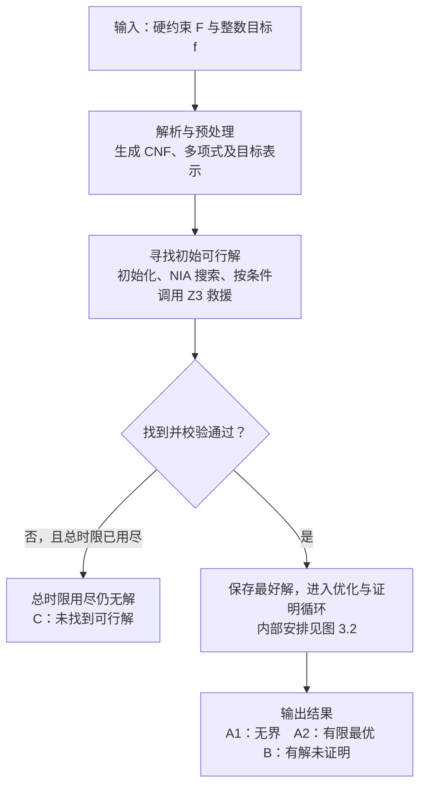
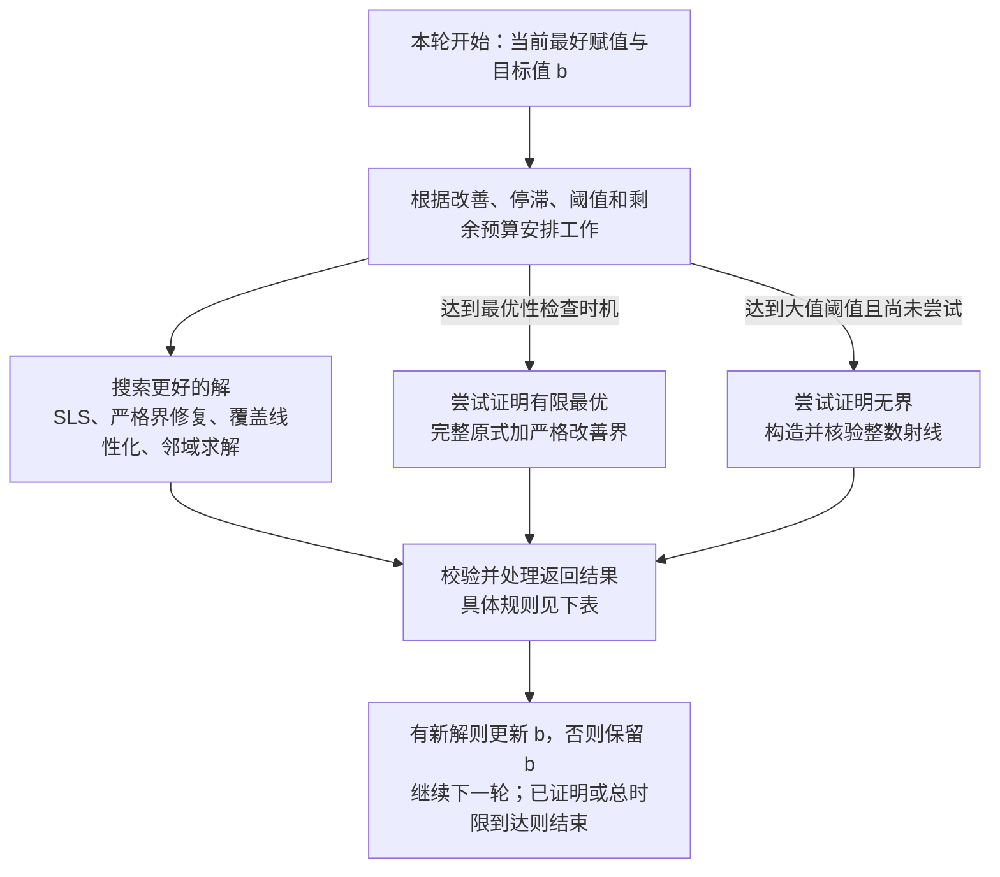

# 当前 OMT(NIA) 算法流程与创新点梳理

整理日期：2026-11-02。本文根据当前源码梳理，不以历史讨论、模块名称或旧实验总结代替实现事实。

代码基准为 Git `3090a2a3c3e454c0097acdab3734a7ff53e7ceae`，当前完整实验入口为 [run_full_node1_3.sh](../script/run_full_node1_3.sh)。所核对的 `build/z3` SHA256 为 `14c5c9dc00d45990987c82820410bb10d450bde772178b6153bf8767dc0bd9db`。本文描述当前实现，不重新运行实验，也不根据已有成绩反推各模块的贡献。

## 1. 当前求解器究竟由什么组成

输入是一个带单个整数目标的 SMT 问题：

\[
\min / \max\ f(x),\qquad F(x),\quad x\in\mathbb Z^n\times\mathbb B^m.
\]

可以把当前实现理解成四个相互连接的层次：

1. **Z3 前端和原生问题表示。** 解析原 SMT、预处理、保留经过同步改写的目标表达式，形成 NIA_LS 能直接搜索的 CNF 与多项式表示。
2. **寻找可行赋值的搜索层。** 渐进式线性化初始化、已有 NIA 局部搜索及其可恢复版本，负责找到第一个满足硬约束的赋值。
3. **目标感知的优化层。** 独立维护最好赋值，用增量评估、代数投影、多变量邻域、严格改善修复等方法持续改善目标。
4. **证明与信息交换层。** 对完整原式检查严格改善条件；从 SAT 模型获得更好赋值，从 UNSAT 获得最优性。同时提供核心引导邻域、结构化证明辅助和无界射线证明。

它同时具有分配时间给不同过程的调度，以及具体信息的传递。已经交换的信息包括赋值、目标界、部分冲突核心变量和经验证的子问题答案。还没有在 Z3 的 CDCL(T) 主循环中让 NIA_LS 直接参与理论传播、冲突分析或共享全部学习子句。

NIA_LS 作为对象库链接进 Z3 shell，Z3 API 符号来自该 shell 的 Z3 核心。最优性检查为了保留硬截止和续传能力，会 fork 子进程；“同一个可执行文件”不等于“所有模块一直处在同一个进程、同一个上下文中”。

实现依据：[shell 入口](source/src/shell/main.cpp) 389–399 行、[链接配置](sls/CMakeLists.txt)、[前端](sls/frontend/nia_frontend.cpp) 228–263 行、[优化控制器](sls/src/nia_omt_optimize.cpp) 543 行起、[证明 worker](sls/src/nia_omt_optimality.cpp) 733–984 行。

## 2. 先明确本文所说的“当前配置”

底层选项的默认值、直接调用前端的默认模式，以及批量实验脚本实际传入的选项，是三件不同的事。

直接执行 `z3 --nia-ls input.smt2`，没有指定其他执行模式时，前端默认进入 `optimal` 模式，开启优化、有限最优证明和无界证明。底层 `OmtOptimalityOptions` 中这些增强开关本身大多默认为关闭；不能只看结构体默认值就判断当前实验没有使用它们。

本文以下主流程以当前完整实验脚本为准：

| 项目 | 当前完整实验的实际设置 |
| --- | --- |
| 实例集合 | original 5744 + new 566，共 6310 例 |
| 单例预算 | 1200 秒，包括导入与后续求解 |
| 并行 | node1、node2、node3，每台最多 180 例 |
| 目标来源 | 自己找到并校验的 incumbent，不以对手目标提前停止 |
| 基础初始化 / 重启修复 / 等式保护 | 开启 |
| 有限大目标尝试 | 开启，幅值 `1000000` |
| 无界证明 | 开启，方向性触发阈值 `1000000` |
| 最优证明 | 开启；改善后通常等待 10 秒，首次证明片 30 秒 |
| 证明续传 / burst / finite cutset / balanced | 开启 |
| 无初始解时的原式 Z3 救援 | 批量运行的 native 阶段计时达到 300 秒后尝试一次，最多 120 秒 |
| core-neighborhood | 显式开启 |
| convex-exchange | 显式开启，当前使用基本凸二次切平面版本 |
| smt-exchange | 显式设为 `hints` |
| 原式 BV 阶段 | 显式开启，软墙钟预算 120 秒，后接默认策略 |
| guarded-product | 显式开启，辅助阶段最多约 3 秒 |
| objective-slice / integer-convex / integer-affine-convex | 当前脚本未开启 |
| slack-repair / isolate-exchange-context / optimality-tail / advisory-share | 当前脚本未开启 |

特别注意：当前完整配置中的有限大目标是 **\(10^6\)**。\(2^{127}-1\) 是该参数允许的最大幅值，不是这份完整实验脚本当前使用的数值。

实现依据：[完整脚本](../script/run_full_node1_3.sh)、[批量配置](experiment/run_embedded_slurm.py) 69–84 行、[实际 native 参数构造](reference/script/run_optimize.py) 642–667 行、[底层选项](sls/src/nia_omt_optimize.h)、[直接前端的模式处理](sls/frontend/nia_frontend.cpp) 210–224 行。

## 3. 一次求解从头到尾怎样执行

### 3.1 从输入到输出

先看整体分成哪几个阶段；优化循环的内部安排在下一张图展开。



寻找初解这个阶段内部会持续搜索和修复，并在条件满足时调用 Z3 救援；一次初始化失败不会直接变成 C。上图省略解析错误、原硬约束不可满足等异常或独立结论，它们仍记录在原始状态中。

### 3.2 优化循环中的一轮工作

有初解后，每轮围绕当前最好赋值和目标值 \(b\) 安排一段工作。下图的三个分支表示**按条件调度的工作类型**，不是三个阶段每轮依次执行，也不是三个引擎同时运行。



用“继续下一轮”收拢循环回边，返回结果按以下规则处理：

| 本轮返回什么 | 接下来做什么 |
| --- | --- |
| 搜索得到更好的可行赋值 | 完整精确检查，更新 \(b\)，进入下一轮 |
| 原式严格改善查询 SAT，且模型成功回灌并校验 | 更新 \(b\)，继续搜索或使用本次证明窗口的剩余时间 |
| 原式严格改善查询 SAT，但模型未能回灌 | 保留 \(b\)，返回搜索；这个旧界不再重复寻求 UNSAT |
| 完整原式的严格改善问题已被证明 UNSAT | A2：确认有限最优，结束 |
| 整数无界射线核验成功 | A1：确认无界，结束 |
| 未找到改善、证明 UNKNOWN、证明片耗尽或无界未证 | 保留 \(b\)，继续搜索，并按调度条件安排后续工作 |
| 单例总时限耗尽 | 已有可行解则为 B；始终没有可行解则为 C |

这里的 SAT 指原式查询的 SAT，不包括单项式实数放松的 SAT。后者不能直接作为原整数模型回灌。

所有阶段共享单例总预算。**证明片耗尽只结束或暂停这一片工作；单例总时限耗尽才终止整例。** 因此某次证明片用完，不会重新发放 1200 秒。

### 3.3 批量运行怎样对应到上述流程

当前批量执行还分成两个外部阶段：先运行同一 `z3` 的 `--import-only --export-native=...`，再运行它的 `--native-input ... --optimize`。因此批量导入和优化可以是两个进程；直接传入 SMT2 的用法则在前端转换后调用 native 优化入口。两种方式都使用当前内嵌的 C++ 导入器，不依赖旧 Python Z3 converter 求解。

实现依据：[命令适配](experiment/runtime_adapter.py) 66–79 行、[优化控制器](sls/src/nia_omt_optimize.cpp) 543–1239 行。

## 4. 读入：保留的是目标语义，不是强行保留原目标变量名

### 4.1 解析与适用范围

前端先过滤 SMT-LIB 命令，再用 Z3 的 `optimize.from_string()` 提取约束和目标；这里没有调用 `Optimize.check()` 求最优值。只接受一个标量 Int 目标，拒绝多目标、增量 push/pop 等不支持的执行方式。源文件中的求解选项和输出命令不直接支配本轮运行。

为了避免最大化目标被 Optimize 的内部表示取负，解析时统一写成 `minimize 原表达式`，同时单独保存原来的 `min/max` 方向。搜索和证明都按保存的真实方向比较目标。

### 4.2 目标如何穿过预处理

对目标 \(f(x)\) 建立一个新鲜的 Bool 值函数标记 `marker(f(x))`，和硬约束一起交给 tactic。默认顺序是：

```text
F ∧ marker(f)
  → simplify
  → propagate-values
  → solve-eqs
  → simplify
  → elim-term-ite
  → simplify
  → 提取 marker 中经过同步改写的目标，去掉 marker
  → tseitin-cnf
```

例如原目标是 `obj`，约束有 `obj = x*x + y`，预处理可以把 `obj` 消去；只要 marker 中同步变成 `x*x + y`，后面仍然能够优化这个表达式。目标保护不要求原来的 `obj` 符号始终留在搜索变量表里。

`--keep-definitions` 只是修改 `solve-eqs` 的 `theory_solver` 参数，不代表完全禁止消元。`--no-preprocess` 也仍保留部分 simplify、ITE 消除与 CNF 化。

当前批量导入对原始 `QF_NIA/leipzig/` 路径显式加 `--keep-definitions`。这是确实存在的输入兼容配置，不能把整套批量路径描述成完全没有按类别选择参数。

### 4.3 搜索表示

导入后使用：

- Int/Bool 变量表；Bool 赋值用 \(-1/1\) 表示。
- 去重的单项式池，单项式是变量与正整数幂的乘积。
- 多项式等式 \(p=0\) 或非严格不等式 \(p\le0\) 文字；否定由文字符号表达。
- 硬约束 CNF，以及独立保存的多项式目标。
- 变量、项、文字、子句之间的出现索引，用于增量更新。

整数严格比较通过偏移 1 编码。例如 \(p<0\) 变成 \(p+1\le0\)。多项式展开超过内部项数预算时，导入器引入带精确等式定义的辅助变量，没有丢掉高阶项。

预处理后仍存在的不支持算术运算会报错。例如源文本中的 ITE 可以先消去；不能据此把所有出现过 ITE 的源文件都视为不支持。

实现依据：[导入器](sls/frontend/nia_import.cpp) 96–129、203–335、348–408、449–557 行、[native 构建](sls/src/nia_omt_input.cpp) 262–416 行、[Leipzig 参数](reference/script/run_optimize.py) 584–586 行。

## 5. 初始解：先构造提案，再做精确检查

### 5.1 渐进式初始化

初始化器把非线性约束在小有限域上表达为线性/条件形式，调用自写的 `LiaSolver`。它从约束前缀开始：初始大约为全部子句的 \(1/16\)，随后逐步加倍到全部子句；短前缀每次最多检查约 500ms，保留预算给最后阶段。

每个候选都拿回完整的导入约束检查。若还不完全可行，保留未满足子句较少的赋值作为后续搜索种子。初始化器的失败只是没有找到初解，不是 UNSAT。

这里的 `LiaSolver` 虽然使用 Z3 AST 和模型对象，却是自己实现的局部搜索后端，不能把它称为“调用 Z3 完备 LIA 求解器”。

### 5.2 复用 NIA 可行性搜索

没有初解时，运行 `OmtFeasibilityContinuation`。它将已有 NIA 搜索拆成可暂停片段，保留随机数状态、未改善计数、搜索缓存等，后续时间片接着原来的轨迹搜索。

基础搜索在 Bool 与整数模式之间切换。它从假文字生成线性/二次临界值候选，以修好、破坏的子句权重评价动作，结合 tabu、等式保护、随机游走、动态权重和重启修复。

当前优化入口先给这条轨迹至多约 60 秒；没有初解时，之后仍会与 GMP 主搜索轮转。它开始保留旧算术启发式以保留原有搜索轨迹，但候选发布前必须通过独立 GMP 检查。旧候选检查失败会切换受检算术 continuation。因此不能称当前所有候选生成运算都使用任意精度整数。

基础搜索的重启修复也包含实际求解步骤：从本轮最好赋值出发，按冲突和非线性结构冻结部分坐标；把剩余非线性因子在参考赋值附近的有限域上展开成 ITE 线性表达式，交给自写 `LiaSolver`。失败后可以减少冻结量，为部分因子扩域或加入较远的临界点；只有原硬子句冲突数下降或全部满足，才安装为新的重启种子。临时冻结和小域只属于私有修复问题，不成为主搜索永久约束。

### 5.3 原式 Z3 救援

当前批量配置在 native 阶段计时达到 300 秒还没有初始解时，最多调用一次原式可行性查询，给约 120 秒。前一进程的 SMT 导入耗时不计入该 300 秒触发钟，但已占用包含导入的单例总预算。该查询只检查 \(F\)，不带目标改善条件。SAT 模型成功恢复到 native 后才能成为初解；这次查询的 UNSAT 不会被写成“找到了有限最优”。

实现依据：[渐进初始化](sls/src/nia_linear_initialize.cpp) 246–307 行、[基础 NIA 搜索](sls/src/nia_ls.cpp) 1169–1219 行、[continuation](sls/src/nia_omt_feasibility.cpp)、[重启修复](sls/src/nia_restart_repair.cpp) 75–191、224–326 行、[初始化与救援调用](sls/src/nia_omt_optimize.cpp) 732–808、930–943 行。

## 6. 优化主循环：怎么一步步把目标变好

### 6.1 区分当前搜索状态与最好赋值

`State` 是正在探索的赋值，可以暂时不满足硬约束；`best` 是已经独立校验过的最好可行赋值。扰动或修复失败不会覆盖 `best`。

每次接纳候选统一走 `accept()`：用 GMP 从赋值重新计算全部单项式、文字、硬子句和目标，不信任增量缓存；已有最好值时只接纳严格改善；模型文件和 incumbent 事件还必须在截止时间内发布。目标更新后，相应的旧严格界证明 session 会被重置。

搜索坐标存储为 signed 128-bit，优化层的多项式值、残差和目标值使用 GMP，因此目标值本身可以超过 128 位。系数和坐标的表示范围不等于整个数学目标的范围。

### 6.2 变量怎么选，候选值怎么来

可行时，扫描决策坐标并优先考虑目标依赖的变量；不可行时，随机选一个未满足子句，围绕相关变量进行修复。

候选来源包括：Bool 翻转；整数的 0、相反数、邻近点、搜索半径点及真实端点；目标相关变量的远点；固定其他变量后单变量线性/二次约束的根附近点；目标驻点附近点。对于带定义投影的坐标，还会用投影后的探测结果估计局部二次目标。

候选临时应用后，只重新计算受影响的项、文字和子句，撤销后比较结果。真正选中时再提交差分。这是计算性能层面的增量评估。

### 6.3 一个动作怎样保持相关等式

动作会尝试代数投影：请求修改的坐标不被覆盖，其他单次出现的一次变量可以按等式精确整除求出。对于可识别的守卫等式、常量条件定义，还会同步刷新被决定的变量。

例如约束为 \(x+y=10\)，请求把 \(x\) 增加 1 时，若结构和界允许，可以同时把 \(y\) 减少 1，避免两个独立坐标动作之间必然经过不可行状态。

这不是一个通用方程组求解器：一般等式只做有限轮投影，整数除不尽、越界或结构不支持时，仍交给后续搜索处理。也不是所有等式定义变量都被永久排除扫描；专门排除的是可拓扑展开的一类常量条件输出。

### 6.4 候选怎么排序

主要顺序是：加权未满足子句代价，再比较修复距离，最后比较目标值。主循环还加一个“虚拟严格改善界”：如果候选没有优于自己当前的最好值，就增加额外代价和目标距离压力。

可行状态下的普通动作必须保持全部硬约束并严格改善。不可行状态下可以逐渐修复，但若当前目标已经优于 incumbent，普通动作不允许轻易退回失去改善的目标区域。

这不等于把“目标值越好”放在所有硬约束之前，也不是每发现一个更大的数就更新结果。

### 6.5 单坐标走不动时

当前优化路径中已有以下结构化动作，按条件触发：

| 动作 | 处理的搜索障碍 | 接受前提 |
| --- | --- | --- |
| 零乘积联合修改 | 一个乘积有多个零因子，改单个坐标仍为零 | 完整候选评估 |
| 双坐标反向交换 | 单坐标受资源守恒等关系限制 | 硬约束可行且改善 |
| 差分约束联动修复 | 改善目标后需要联动调整其他坐标 | 固定 probe 后求差分约束见证，再完整检查 |
| 非线性目标严格前沿 | 需要两个目标坐标以不等幅方式变化 | 在目标严格改善边界附近探测 |
| 析取分支重新选择 | 当前差分约束分支产生负环 | 根据负环中的选择原因尝试替代文字 |
| 可行中性步 | 需要先重排，目标才能继续改善 | 保持目标及硬约束，严格降低固定压力场 |
| 目标 kick / Bool 守卫联合 kick | 小范围严格改善都被阻挡 | 允许暂时不可行，由后续修复；不立即发布 |
| 扰动、子句重加权 | 当前搜索长期停滞 | 保留独立 incumbent |

差分联动使用 Bellman–Ford 一类图过程；析取版本允许换成当前尚未满足的替代文字，并依据负环冲突选择扩展分支。不能把它概括成始终只在当前布尔分支中搜索。

许多较贵动作有变量数、时间、调用频率等结构限制，例如不超过 100 个搜索变量、运行 60 秒之后稀疏触发；它们不是每轮无条件执行。

### 6.6 改善方向加速

一旦从赋值 \(a\) 改善到 \(b\)，在没有标记为定义变量的整数坐标上提取联合变化 \(d_i=b_i-a_i\)，将这些坐标依次设置为 \(a_i+2d_i,a_i+4d_i,a_i+8d_i,\ldots\)。Bool 等其他坐标以当前最好赋值为起点，计算变量再由现有投影尝试同步修复。每个点都检查硬约束并要求严格改善。越过坐标表示范围、失去可行性或不再改善时停止。

这属于找有限更优值的加速，不构成“这条方向永远可行”的数学证明。

实现依据：[精确接纳](sls/src/nia_omt_optimize.cpp) 48–74、609–647 行；[State 与投影](sls/src/nia_omt_optimize.cpp) 76–514 行；[方向加速](sls/src/nia_omt_optimize.cpp) 831–850 行；[动作排序及越平台](sls/src/nia_omt_optimize.cpp) 1019–1236 行；[差分修复](sls/src/nia_omt_difference.h)、[析取图搜索](sls/src/nia_omt_disjunctive.h)。

## 7. 两类严格改善修复：把优化重新交给可行性搜索

### 7.1 私有 NIA 严格界修复

设当前最好目标为 \(b\)。在完整 native 硬约束的私有副本中加一个真实单子句：

\[
\begin{cases}
f(x)-b+1\le0,&\min;\\
-f(x)+b+1\le0,&\max.
\end{cases}
\]

整数目标下，这正好分别表示 \(f<b\) 与 \(f>b\)。以 incumbent 为种子，复用可暂停的 NIA 可行性搜索。同一个 \(b\) 下续搜；\(b\) 改善后重建对应副本。

这个 helper 复用的旧 NIA 临界动作生成仍有 `int` 收窄，因此对新增严格界的部分系数和常数主动做 `int` 范围检查。超范围只让该修复路径不适用，不是整个 GMP 优化器不支持该目标，更不能据此判最优。

### 7.2 固定因子后的线性化修复

`OmtBilinearRepair` 的实际能力已经超过文件名中的“双线性”：

1. 收集硬约束和目标中的非线性因子关系。
2. 二分双线性结构可按因子图着色选择固定侧；其他多项式尝试构造覆盖集。
3. 固定足够的变量，使每个单项式最多剩一个一次自由变量，于是剩余完整 CNF 变成 LIA。
4. 在该 LIA 问题中加入自己的严格改善界，其他自由坐标仍可在真实界内调整。
5. 以短片调用自写 `LiaSolver`；私有工作状态可以保留有希望的部分候选。
6. 回到原非线性多项式做完整精确检查，确实可行且改善才返回主循环。

固定集的试点兼顾 incumbent 附近、小域组合、0 和远距离幂次点。失败不会得到全局 UNSAT：这里只尝试了有限的固定方式和不完备的搜索。

初始化与重启修复也使用有限域/线性化和 `LiaSolver`。该后端的结果是 SAT 或 UNKNOWN；它不会因为局部搜索失败而证明 UNSAT。

实现依据：[严格界副本](sls/src/nia_omt_repair.cpp) 169–230 行、[覆盖线性化](sls/src/nia_omt_bilinear.cpp) 48–203、313–496 行、[自写线性搜索](sls/src/nia_lia_sls.h) 329–469 行、[调用节奏](sls/src/nia_omt_optimize.cpp) 983–1016 行。

## 8. 与 Z3 的三种实质性交互

### 8.1 核心引导的可扩张邻域

从当前最好赋值 \(a\) 出发，构造：

\[
F_{native}(x)\land Improve(f,b),
\]

对暂时不释放的坐标，通过 assumptions 加上锚点 \(x_i=a_i\)。开始释放计算变量和一个目标相关坐标，其余大部分坐标先固定。

- SAT：提取整个 native 赋值，精确检查并确认严格改善，再回灌主循环。
- UNSAT 且 core 包含锚点：从 core 对应变量中释放一个，再查询更大的邻域。
- UNKNOWN：没有可靠冲突信息支持进一步释放，结束这次 incumbent 的邻域尝试。
- 空 core 的 UNSAT：当前接口只报告邻域耗尽，不把它升级为原 SMT 的全局最优证明。

core 中出现过的变量还会反馈给主 SLS，优先扫描这些坐标。这是已经实现的“Z3 冲突信息指导 SLS”，但信息粒度是邻域锚点核心变量，不是任意理论冲突、完整 learned clauses 或 nlsat 的内部解释。

当前单片至多约 2 秒，总投入至多 `min(60秒, 总预算×10%)`；目标改变后清掉旧邻域。

### 8.2 SLS 赋值作为原式 SMT 的软提示

`smt-exchange=hints` 在严格改善证明 worker 内创建一个使用 `arith.solver=2` 的 SMT 预检后端。按变量名字匹配可见的整数坐标，将 SLS 值通过 `set_initial_value()` 传入，最多预检约 5 秒。

这些值是软初始值，不是 \(x=a\) 硬等式，因此不会为了迁就当前模型而缩小完整原式查询的可行域。未匹配变量不强行猜测映射。

预检有明确 SAT/UNSAT 才使用其答案；未知则保留完整原式查询，进入后续原策略。当前没有安装用户传播器或让 SLS 在 SMT 每次决策中回调。

### 8.3 原式 SAT 模型回灌

Z3 在原始严格改善查询中返回 SAT 后：

1. 检查原式 hard assertions，精确计算原目标并确认改善。
2. 根据名字和类型，将共享变量的原式取值固定到 native 表示。
3. 对 native 全部 CNF 和“native 目标等于原目标值”求一个补全模型，补齐辅助变量。
4. 坐标必须可表示为 signed 128-bit；用 GMP 重算全部 native 子句和目标。
5. 父进程再次校验后，通过统一 `accept()` 更新 incumbent。

因此“Z3 查询 SAT”与“已经成功更新本地搜索赋值”不是同一事件。补全超时、坐标越界等会导致回灌失败，但不会把 SAT 改成 UNSAT。由于该界已被 SAT 反驳，续传模式不会在 incumbent 不变时反复期待同一查询变成 UNSAT。

实现依据：[核心邻域](sls/src/nia_omt_core_neighborhood.cpp) 237–350、380–428 行、[核心反馈主搜索](sls/src/nia_omt_optimize.cpp) 857–910、1028–1031 行、[SMT 软提示](sls/src/nia_omt_optimality.cpp) 479–565 行、[模型桥](sls/src/nia_omt_model_bridge.cpp) 166–290 行。

## 9. 有限最优证明：证明不存在更好的原式模型

### 9.1 证明的问题

有了已校验的目标值 \(b\)，重新读原 SMT 源文件，提取完整硬约束和原目标，构造：

\[
Q_b=F_{source}\land
\begin{cases}
f_{source}<b,&\min;\\
f_{source}>b,&\max.
\end{cases}
\]

该过程使用 Optimize 对象解析，不调用它的优化接口。目标方向与原目标文本会和导入元数据核对。

只有 \(Q_b\) 的 UNSAT 才支持有限最优结论。SAT 可以提供更优模型；UNKNOWN、暂停、预算用尽、不支持和异常都不证明最优。搜索停滞、有限邻域穷尽也不能代替这个结论。

最优性还以前面的可行 incumbent 为前提。原式 UNSAT 查询本身不独立重放导入等价性，也不同时认证每一个 SLS 历史模型。

### 9.2 当前证明 worker 内部的实际顺序

按当前完整配置，先后尝试：

```text
构造完整原式严格改善查询
  → guarded-product 的 Real 单项式放松
  → 凸二次目标的线性切平面求解
  → 小有限非线性割集的完整枚举
  → 带 SLS 整数软提示的 SMT 预检
  → try_for(qfnia-omt-bv, 120秒) | default
```

源码还在 guarded-product 后接入了可选 objective-slice，但当前完整脚本没有开启。

前一阶段给出可采纳答案，后面的阶段就不执行。前一阶段不适用或无结论才继续；预算可能先耗尽，所以“配置了 BV”不代表某个实例实际上跑到了 BV。

当前没有开启公共 `advisory-share` 前缀。guarded-product、SMT 预检有自己的软阶段限额；凸切平面和 finite cutset 则受外层证明片及自身资源条件控制。特别是在持久 worker 中，父进程可以暂停它们，后续仍接着该阶段；不能假设每片一定给最后的默认策略预留固定时间。

### 9.3 guarded-product：把非线性后果交给线性实数算术

这一阶段接受受限的整数二次多项式及 `and/or/not` 比较骨架，把不同单项式映射为独立 Real 坐标，得到必要条件放松。例如 \(x y\) 换成坐标 \(p_{xy}\)，但不直接保留完整乘法语义。

为加强放松，加入一批对整数原式成立的后果：

- 原等式 \(p=0\) 成立时，加入受该等式保护的 \(v p=0\)。
- 若两个当前极性事实分别保证 \(h\ge0,k\ge0\)，加入受两个事实保护的 \(hk\ge0\)。
- 严格改善界也参与这些事实；整数严格比较的偏移 1 被保留。

生成是有索引和预算的有限一轮：候选最高到三次、乘积至少一个因子仿射，并受单项式库存、扫描和 cut 数量限制。不是一般多项式闭包，也不是穷尽所有三次推论。

例如 \(x\ge0,y\ge0,z=xy\)，最小化 \(z\) 已找到 0。加入 \(z\le-1\)，放松中有 \(z=p_{xy}\)，有效乘积后果给 \(p_{xy}\ge0\)，线性算术即可发现矛盾。

数学依据是每个原整数模型都可以用真实单项式值扩展为放松模型，因此 **放松 UNSAT ⇒ 原严格改善查询 UNSAT**。反向不成立；放松 SAT 不能回灌成整数模型，也不能禁止以后继续证明同一个界。

实际调用 `QF_LRA`，使用独立辅助 context，阶段约 3 秒。独立 Bool 原子、ITE、div/mod、一般幂或量词等不在这个 helper 的支持范围；不支持时回退，不影响主原式查询的保留。

### 9.4 convex-exchange：凸二次目标的外近似

适用时，原目标或它的直接等式定义可以投影成二次函数，其他原始硬约束经该投影后是 QF_LIA。统一目标方向后，需要精确验证二次型半正定。

对规范化最小化函数 \(q\)，在点 \(a\) 构造切平面：

\[
L_a(x)=q(a)+\nabla q(a)^T(x-a)\le q(x).
\]

严格改善要求 \(q(x)\le b-1\)，所以必要条件是 \(L_a(x)\le b-1\)。将这些线性条件和原线性硬约束交给 QF_LIA。

- 线性问题 UNSAT：必要条件已经矛盾，可证明原严格改善问题 UNSAT。
- 线性问题 SAT：精确计算原二次目标；确实改善且满足原 hard，才返回原式模型。
- 否则在新的点继续加切平面。

初始切点可以取 SLS 可见坐标，凸性与切平面计算用精确整数/有理数。当前没有开启另外实现的整数平方割或仿射平方分解版本。

### 9.5 finite cutset：有限域覆盖后逐支变成 LIA

从可靠的线性条件推导有限变量域，选择一组变量，使它们固定后所有非线性单项式都退化成线性。只有覆盖域足够小、分支代价可接受时才做完整枚举。

每个叶子保留完整查询，经替换确认是 QF_LIA 后求解。任一叶子 SAT 可以给候选；**所有可能叶子都 UNSAT** 才能证明原查询 UNSAT。抽样、未覆盖或枚举超时均不能充当证明。

### 9.6 BV 与默认策略

新增的 BV 路径放宽了该 SAT 子阶段原有的局部冲突与内存门槛，但仍受调用方和全局限制，并由软墙钟预算控制。实际使用的是 `qfnia-omt-bv` 加默认回退，不是把所有注册的 OMT tactic 都依次运行一遍。

`nla2bv` 的有限表示和欠近似保护仍在：如果只覆盖了整数域的一部分，有限 BV 搜索无解不能据此证明整个整数问题 UNSAT。不能把这里的 `max_bv_size=64` 理解为整个求解器把整数语义改成了 64 位整数。

实现依据：[原式证明与辅助顺序](sls/src/nia_omt_optimality.cpp) 152–198、273–629 行、[guarded-product](sls/src/nia_omt_guarded_product.h) 71–323 行、[凸外近似](sls/src/nia_omt_convex_exchange.cpp) 366–494 行、[有限割集](sls/src/nia_omt_cutset.cpp) 171–277 行、[BV tactic](source/src/tactic/smtlogics/qfnia_tactic.cpp) 36–158 行。

## 10. 证明时间怎样与 SLS 交替

当前完整配置的典型节奏为：

1. 接纳新 incumbent，重置等待时刻，通常先给 SLS 10 秒改善机会。
2. 达到证明时机，首次给证明 worker 约 30 秒。
3. 若没有结论且期间没有改善，下一证明片通常加倍；balanced 模式同时给 SLS 至少与下一证明片一样长的窗口。
4. 若 SLS 找到新改善，下一证明片可以缩为上一片的一半，并重新等待正常 stall。
5. 若严格改善查询 SAT，则当前界已被反驳；成功回灌模型后收紧界。如果没有成功回灌，仍不会在这个旧界上反复寻求 UNSAT。
6. burst 允许在同一证明窗口内连续接受 SAT 改善并查询更紧的界，但每次只能使用这个窗口剩下的时间。

持久证明 session 的具体实现是：相同目标界与输出路径时保留 fork 子进程，片结束 `SIGSTOP`，下次 `SIGCONT`。因此可以保留该查询内部的 Z3 搜索进度。新 incumbent 改变严格界时，旧 worker 被清理后重建。

这是一种同界查询的进程级断点续传。当前没有把前一个目标界下的学习状态通过 `push/pop` 一直跨界积累。SLS 与活跃的最优证明主要交替分配时间，不是每个实例各自无上限地同时跑两套独立求解。

解析、上下文构建、模型补全、结果读取和清理都占预算。迟到结果不被当成时限内证明；结束时保留之前已经验证的 incumbent。

实现依据：[调度器](sls/src/nia_omt_optimality_schedule.h) 16–70 行、[burst 调用](sls/src/nia_omt_optimize.cpp) 651–730 行、[session 暂停恢复](sls/src/nia_omt_optimality.cpp) 833–984 行。

## 11. 大数搜索与真正的无界证明分别做什么

### 11.1 有限阈值尝试

已有至少 3 次目标改善，且相对初值的累计改善达到一定幅度后，有限大目标调度器尝试让目标越过 \(\pm M\)：最大化为 \(f\ge M\)，最小化为 \(f\le-M\)。当前 \(M=10^6\)。

这里使用不等式，没有强迫目标恰好等于某个整数。总补充预算至多约 30 秒，每片至多 1 秒，间隔约 5 秒，通过私有严格界修复结构寻找候选。

达到阈值只能说明找到了一个很大的有限值，不构成无界证明。

### 11.2 当前无界证明是一条经过精确检查的整数射线

达到方向性阈值后，当前至多尝试一次无界证明，最多约 5 秒。它从 incumbent \(a\) 开始：

1. 在 native 每个 CNF 子句中，选择一个当前为真的文字，覆盖全部子句，倾向 Bool 或线性文字。
2. 贪心选择一批变量，固定为 \(a\) 中的值，使所选文字和目标都退化为仿射表达式。最多尝试 8 种选择变体。
3. 为方向向量 \(d\) 建立 QF_LIA 问题。固定变量和 Bool 的方向为 0；所选正等式的斜率为 0；不等式和负等式按基点所在的真分支约束斜率，使所选文字沿 \(t\ge0\) 始终为真。目标斜率要求 min 至多 \(-1\)，max 至少 \(1\)。
4. LIA SAT 得到候选 \(d\)，再用 GMP 对原 native 多项式和 CNF 独立核验。

被核验的结论是：

\[
\forall t\in\mathbb Z_{\ge0},\quad F_{native}(a+t d),
\qquad f(a+t d)=f(a)+t\Delta,
\]

其中最小化 \(\Delta<0\)，最大化 \(\Delta>0\)。选中文字对任意 \(t\ge0\) 始终为真，所以每个子句始终有见证；目标随 \(t\) 向所需方向无界增长。

这是符号证明，不需要真的把搜索赋值推到每一个大整数。搜索坐标使用 128 位，不代表这里把数学上的 \(t\) 限制为 128 位。

某一种固定方式的方向问题 UNSAT 只表示没找到那种射线，不证明原问题有界。所有变体失败仍然继续优化。当前证书也不覆盖任意非线性参数曲线、任意切换布尔分支的无界性，或目标保持非线性增长的所有情况。

这条证书证明的是 native 问题上的射线；从原 SMT 到 native 的等价性仍由导入变换承担，不是射线 verifier 再独立证明一遍。

实现依据：[有限阈值调度](sls/src/nia_omt_large_target.h)、[无界触发](sls/src/nia_omt_optimize.cpp) 583–607 行、[阈值修复](sls/src/nia_omt_optimize.cpp) 944–980 行、[射线构造与核验](sls/src/nia_omt_unbounded.cpp) 152–369 行。

## 12. 当前保证到哪一步，哪些话不能直接说

| 当前可以依据实现说明的性质 | 需要保留的边界 |
| --- | --- |
| 每个发布的 incumbent 经 GMP 重算完整 native CNF 与目标 | 不等于每个 SLS 模型都已恢复全部原 SMT 变量 |
| 原式 Z3 SAT 模型可补全为 native 模型再校验 | 补全可能失败；这是 source→native 桥，不是通用双向 model-converter |
| 完整原式严格改善查询 UNSAT 排除更优原式模型 | 有限最优还依赖 incumbent 可行性及目标保持的导入前提 |
| guarded/convex 的有效放松 UNSAT 支持原式严格改善无解 | 放松 SAT 不自动给原整数解；必须按相应规则精确检查 |
| 全有限覆盖逐支 UNSAT 可作为证明 | 小样本、局部固定和 UNKNOWN 不能代替全覆盖 |
| 无界射线有独立整数核验逻辑 | 覆盖受限，不完整；核验对象是 native CNF |
| 证明和模型有总预算及迟到拒收规则 | 一些内部阶段仍是软时限，最外层进程截止才提供硬约束 |

**模型输出尤其需要准确表述。** 当前导入器没有序列化 tactic 的 model-converter，也没有保存一般的 `solve-eqs` 消元回译。因此 `model.tsv` 只输出 native 变量表中的变量；批量最终模型验证读取的是 `input.nia` 与该模型，用精确整数复算 native 问题。不能把它写成“所有 SLS 模型都已自动在完整原 SMT 上逐个重验”。

另一方面，原式证明 worker 确实重新读取完整源式；它的 SAT 模型在源式上检查后才进行 native 补全。两条路径的保证范围应分开陈述。

guarded/convex 等辅助阶段会保存变换证据，但当前没有为每次 LRA/LIA UNSAT 都输出并独立核验完整 proof object。离线 guarded 检查器主要验证源绑定和变换构造，不重做可满足性判定。因此应区分“变换证据可核对”“运行中的 Z3 返回 UNSAT”和“完整证明对象独立检查”。

输出中的可行性与完成状态也是分开的：底层 `status=sat` 只说明有可行赋值，有限最优和无界另有证明字段。汇总的 A1 表示证明无界，A2 表示确认有限最优，B 表示有解未证明，C 表示没有找到可行解。A1 日志里仍可能保留作为射线基点的有限 incumbent，它不是无界问题的“有限最优值”。导入不支持、原硬约束不可满足或执行错误，还要结合原始状态和原因判断，不能仅由 C 推断原式 UNSAT。

实现依据：[native 接纳](sls/src/nia_omt_optimize.cpp) 48–74、609–647 行、[导出模型](sls/src/nia_omt_optimize.cpp) 518–524 行、[模型桥](sls/src/nia_omt_model_bridge.cpp) 166–290 行、[批量验证](reference/script/verify_optimize.py) 199–240、963–975 行、[guarded 离线检查器](experiment/verify_native_guarded_product_certificate.py)。

## 13. 从当前实现中可以提炼哪些研究贡献候选

以下是**可组织成研究问题的已实现机制**，不是已经完成相关工作比较或消融验证的新颖性结论。源码只能回答“做了什么”，不能单独证明“以前没人做过”或“这个模块导致了某个成功数提升”。

### 13.1 以自有严格改善界组织搜索与修复

主搜索、私有 NIA 修复、因子覆盖线性化，以及原式 Z3 都围绕同一个自有 incumbent 工作。不同过程保留各自轨迹，但用统一精确接纳门更新共享目标界。

可以研究：不同候选源如何互补；可续传是否比每次重启有效；精确评估与近似提案分离是否扩大了可用搜索动作。应把贡献落实到具体机制和相应消融，避免仅表述成“组合多个求解器”。

### 13.2 利用非线性结构设计跨平台的多变量动作

已经实现的等式投影、零因子联合动作、严格目标前沿、差分负环驱动的分支重选，以及可行中性移动，处理了单坐标搜索天然跨不过去的状态结构。

可以围绕统一问题表述：如何在离散非线性约束下构造保持或快速恢复可行性的目标改善邻域。需要按结构条件证明动作性质，并验证收益能跨应用出现；不能只以某个应用名称定义方法。

### 13.3 用邻域 UNSAT core 决定该放开哪些坐标

SLS 提供可行赋值，SMT 在锚定邻域上做严格改善查询，core 决定邻域扩张，core 变量再反馈到 SLS 扫描优先级。这条信息回路是具体、可测量的融合机制。

需要分别比较随机释放、无 core 的规模扩张、core 释放，以及是否反馈主搜索。更少负例、更快改善或节省无效邻域调用，才是其有效性的实验依据。

### 13.4 为自有目标界生成结构化证明问题

guarded-product、凸外近似、finite cutset 都围绕当前严格界，把部分非线性证明转为 LRA/LIA：分别利用带守卫的低次代数后果、凸性和小有限覆盖。

这些机制可以成为证明端的重要研究对象。应讲清各自的必要条件关系、覆盖范围和失败回退，并与已有线性化、凸优化外近似、乘积后果方法比较后再界定新意。当前可以主张已经实现了这些具体构造，不能仅凭名称把它们称为全新的代数证明体系。

### 13.5 搜索见证驱动的无界证书

由一个大值可行赋值选择覆盖 CNF 的文字，再固定部分非线性因子，转为整数方向问题，并独立核验一条永久可行射线。这比“数值很大就猜无界”多了明确的数学证书。

后续可以研究固定集选择与证书覆盖范围。需要单独对照只看阈值、仅固定线性化、以及带精确射线核验的差别；不能把失败当成有界。

### 13.6 哪些更适合作为实现基础，而不宜单独包装成核心新意

目标 marker、C++ 前端统一、模型桥、精确输出、进程暂停续传和时间片倍增都很重要。单独“编进 Z3”“增大 BV 预算”“延长证明时间”不足以说明新的求解原理。

更有说服力的组织方式，是围绕上述某一条明确的信息回路或数学构造，把这些工程能力作为支撑，并展示它解决了什么搜索或证明障碍。

## 14. 后续做创新提炼时应补的证据

本文不改算法，也不据此自动启动新实验。后续验证宜保留同二进制、同实例、同预算的对照：

| 拟验证的问题 | 最小对照思路 | 主要观察量 |
| --- | --- | --- |
| 结构化邻域是否真的改善搜索 | 逐项关闭对应动作 | 初解、目标改善次数、时间、胜平负 |
| core 的信息是否比随机释放有用 | 相同邻域预算，不同释放策略 | 查询数、释放数、有效模型、主搜索收益 |
| 模型与软提示是否有价值 | 禁用回灌或禁用 hints，其他保持一致 | SAT 到成功回灌比例、改善时间 |
| 结构化证明是否提供独立覆盖 | 分别关闭 guarded、convex、cutset | 新增 UNSAT、执行阶段、耗时与回退 |
| 续传是否保留了有效进度 | 同等活跃预算，暂停恢复对照重建 | 证明数、实际证明时间、重建开销 |
| 射线构造是否扩大完成集合 | 固定阈值，区分找到大值与射线核验成功 | A1、证书适用率、失败原因 |

所有这些实验还应区分“开关开启”“某实例实际执行”“生成了候选/变换文件”“最终采用该模型或证明”。这四件事在当前实现中并不相同。

## 15. 继续读代码的入口

| 关注问题 | 优先阅读 |
| --- | --- |
| 完整实验究竟开启什么 | [启动脚本](../script/run_full_node1_3.sh)、[批量配置](experiment/run_embedded_slurm.py)、[命令适配](experiment/runtime_adapter.py) |
| 原 SMT 怎样变成搜索问题 | [前端](sls/frontend/nia_frontend.cpp)、[导入器](sls/frontend/nia_import.cpp)、[native reader](sls/src/nia_omt_input.cpp) |
| 优化总体状态机 | [nia_omt_optimize.cpp](sls/src/nia_omt_optimize.cpp) |
| 初解与原 NIA 搜索 | [初始化](sls/src/nia_linear_initialize.cpp)、[continuation](sls/src/nia_omt_feasibility.cpp)、[基础搜索](sls/src/nia_ls.cpp) |
| 约束修复和多变量动作 | [严格界修复](sls/src/nia_omt_repair.cpp)、[覆盖线性化](sls/src/nia_omt_bilinear.cpp)、[差分](sls/src/nia_omt_difference.h)、[析取](sls/src/nia_omt_disjunctive.h) |
| 冲突信息怎样回到 SLS | [core-neighborhood](sls/src/nia_omt_core_neighborhood.cpp) 与主循环调用点 |
| 最优性与时间调度 | [原式证明](sls/src/nia_omt_optimality.cpp)、[调度](sls/src/nia_omt_optimality_schedule.h) |
| 结构化证明子程序 | [guarded-product](sls/src/nia_omt_guarded_product.h)、[convex](sls/src/nia_omt_convex_exchange.cpp)、[finite cutset](sls/src/nia_omt_cutset.cpp) |
| 原式模型如何回灌 | [model bridge](sls/src/nia_omt_model_bridge.cpp) |
| 如何真正证明无界 | [无界射线](sls/src/nia_omt_unbounded.cpp) |
| 返回结果怎样独立复核 | [验证脚本](reference/script/verify_optimize.py) |
